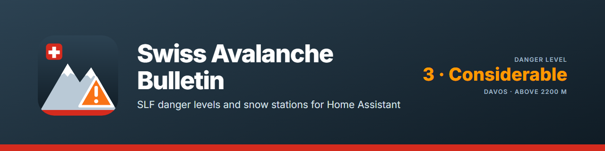
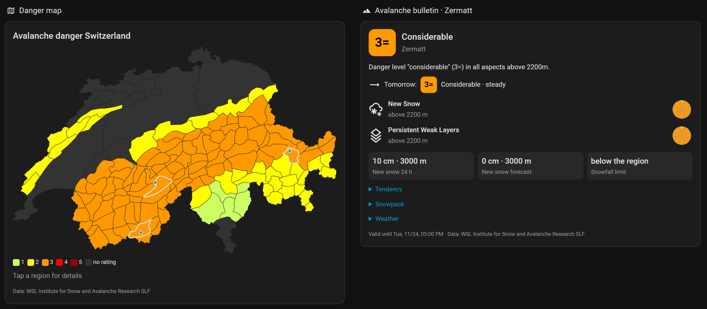
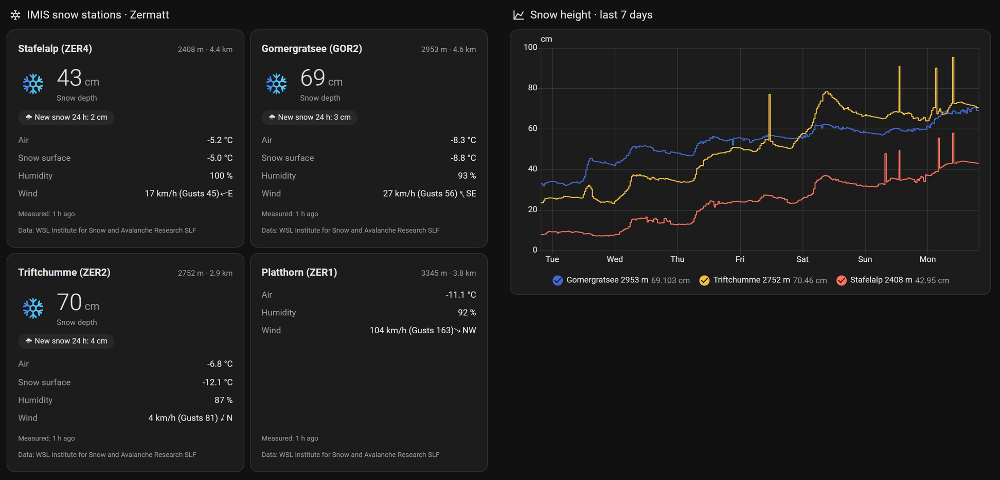

# Swiss Avalanche Bulletin (SLF)

[](https://hacs.xyz/docs/marketplace/)
[](LICENSE)
[](https://github.com/prusuino/ha_swiss_avalanche_bulletin/releases)
[](https://github.com/prusuino/ha_swiss_avalanche_bulletin/actions/workflows/validate.yml)
[](https://github.com/prusuino/ha_swiss_avalanche_bulletin/actions/workflows/tests.yml)
[](https://www.home-assistant.io/)
[](https://developers.home-assistant.io/docs/core/integration-quality-scale/)
[](https://github.com/prusuino/ha_swiss_avalanche_bulletin/releases)
<a href="https://www.buymeacoffee.com/prusuino"></a>



A Home Assistant custom integration for the official Swiss **avalanche bulletin**, published by the **WSL Institute for Snow and Avalanche Research (SLF)** — and, independently of it, for the **IMIS measuring stations** of the SLF: snow depth, new snow, temperatures and wind from ~200 automatic high-alpine stations.

## Highlights

- **The danger level for your spot**: your coordinates are resolved to one of about 150 SLF warning regions; the sensors give the danger level 1–5 with the Swiss subdivision (3−, 3=, 3+), the core zone in the SLF's words ("considerable (3−) above 2200 m"), the region and up to three avalanche problems, refreshed every hour.
- **Tomorrow and the weather, as values**: the level the SLF expects for the next day and the trend (increasing, steady, decreasing — subdivision included), new snow of the last and the next 24 hours, the snowfall limit, wind and temperature — sensors you can automate on.
- **The whole bulletin in your language**: the SLF's texts — avalanche problems, tendency, snowpack, weather review and forecast — come in German, French, Italian or English, whichever Home Assistant uses.
- **Several locations**: home, a cabin, the area of the next tour — each is its own entry.
- **IMIS measuring stations**: about 200 stations in the Alps and the Jura with snow depth, new snow in 24 hours, air and snow-surface temperature, humidity and wind, every 30 minutes from the official measurement API.
- **A danger map of Switzerland**: the bundled map card colours all warning regions in the European danger scale, marks your locations and names any region you tap.
- **The bulletin on one card**: level with subdivision, core zone, tomorrow's level and trend, every avalanche problem with its icon, an aspect rose and the elevation band, new snow and snowfall limit, and the SLF's texts to unfold.
- **A station card and a dashboard**: the bundled "SLF IMIS Station" card with a visual editor, and a dashboard strategy that lays out the map, your locations and stations by itself.
- **Built for the automation editor**: triggers (danger level reached, danger level changed), conditions (danger level at least / below) and a notification blueprint — no templates needed.
- **No value rather than a stale one**: outside the season, and in regions the bulletin lists without a rating (the lowlands in winter), the bulletin sensors report nothing; a station value counts as current only within 3 hours.
- **Light on the network**: all locations share one bulletin download, and an unchanged bulletin is not downloaded again.
- **Set up in a minute**: starts from your Home Assistant location, stations are picked from a list sorted by distance; German, English, French and Italian; diagnostics download with your coordinates redacted.

## Background

The SLF publishes a nationwide avalanche bulletin covering ~150 warning regions across Switzerland, with a public, unauthenticated API (`aws.slf.ch`). This integration:

1. Resolves your configured latitude/longitude to the SLF warning region ("sector") that covers it, using the SLF's own coordinate lookup endpoint.
2. Fetches the current bulletin and extracts the danger rating and avalanche problems for that specific region.

Outside the winter season, or when the bulletin lists your region without a danger rating (in winter that is the case for the Mittelland, the Jura and southern Ticino), the sensors simply report no value rather than a stale or incorrect one, and the attribute `active` is `false`.

**Multiple locations:** add the integration again to track a second location (e.g. a mountain cabin in addition to your home) — each instance is independent.

## What it provides

Per configured location:

| Entity | Description |
|---|---|
| `sensor.slf_avalanche_danger_level_<label>` | Current avalanche danger level as a **number (1–5)**, so it can be used directly in automations/thresholds. Attributes: text label (e.g. "Considerable"), `danger_level_detail` with the Swiss subdivision (`3-`, `3=`, `3+`; `subdivision` holds `minus`/`neutral`/`plus`), `core_zone` (the SLF's sentence on where the level applies), `tendency`, `snowpack`, `weather_review` and `weather_forecast` (the bulletin's texts for the region, as plain text), whether the region currently has a rated bulletin (`active`), validity period, next update time, publication time, the raw danger-rating data (bulletins can split the rating by elevation). The long texts are not written to the recorder |
| `sensor.slf_avalanche_region_<label>` | The SLF warning region name resolved for your coordinates (e.g. "Davos") — lets you confirm the location match is correct |
| `sensor.slf_avalanche_problem_1/2/3_<label>` | Up to 3 currently reported avalanche problems (e.g. wind-drifted snow, persistent weak layers, wet snow). Each includes elevation range, affected aspects (compass directions), the problem's core zone (`core_zone`) and the SLF's full plain-text explanation (`comment`, not written to the recorder). Entities report no value on days with fewer than 3 reported problems |
| `sensor.slf_avalanche_danger_level_tomorrow_<label>` | The level (1–5) the SLF expects for the day after the bulletin's day. Attributes: `danger_text`, `danger_level_detail` with the subdivision, `date` |
| `sensor.slf_avalanche_trend_<label>` | Increasing, steady or decreasing: tomorrow's level against today's, subdivision included (3− < 3= < 3+). The attribute `trend` holds `increasing`/`steady`/`decreasing` in every language — use it in automations — next to `today`, `tomorrow` and the bulletin's tendency text (`comment`) |
| `sensor.slf_avalanche_new_snow_last_24h_<label>` / `…new_snow_forecast_<label>` | New snow (cm) of the last 24 hours and the forecast for the next 24 hours, at the highest elevation the SLF gives for the region (`elevation_m`); `by_elevation` has all of them, e.g. 1500 m and 2500 m |
| `sensor.slf_avalanche_snowfall_limit_<label>` | Lowest snowfall limit (m) of the next 24 hours; `max_m` the highest. When the snow line stays below the region all day the state is unknown and `below_region` is `true` |
| `sensor.slf_avalanche_wind_forecast_<label>` / `…temperature_forecast_<label>` | Wind (km/h, attribute `direction`) and maximum temperature (°C at `elevation_m`, usually 2000 m) of the next 24 hours. **Disabled by default** — enable them under the entity settings |

`<label>` is the label you gave the location when adding it — or, if you left it empty, the name of the resolved SLF warning region — slugified, followed by the last four characters of the config entry id so that two locations with the same label never collide: a location labelled "Home" gets something like `sensor.slf_avalanche_danger_level_home_ab12`, an unlabelled one in the Davos region `sensor.slf_avalanche_danger_level_davos_ab12`. The integration suggests these object ids itself when an entity is first created, so they do not depend on your Home Assistant language — only the displayed names are localized. Entities created by versions before 1.3.0 keep their ids without the four-character part. Like any entity, they can be renamed in the entity settings afterwards.

Data is refreshed every hour. The bulletin itself is typically published once daily (around 17:00), with interim updates during high-danger situations. All locations share one download of the bulletin; the hourly check asks the SLF server whether it changed (ETag) and downloads it again only when it did.

## IMIS measuring stations

The Intercantonal Measurement and Information System (IMIS) consists of about 200 automatic stations in the Swiss Alps and Jura, most between 2000 and 3000 m. When adding the integration, choose **"IMIS measuring stations"** to pick any stations as favourites — the searchable list is sorted by distance from your home location (❄ snow station, 🌬 wind station), and the favourites can be changed at any time via the integration options.

Each station becomes a device with sensors for what it actually measures, updated every 30 minutes via the **official, documented SLF measurement API** ([measurement-api.slf.ch](https://measurement-api.slf.ch/)):

| Sensor | Stations |
|---|---|
| Snow depth (cm) and new snow last 24 h (cm) | snow stations |
| Air temperature, snow surface temperature, humidity | most stations |
| Wind speed, gusts, direction | wind stations and many snow stations |

Their entity ids are built from the station code and the same four-character entry part as the bulletin sensors, `sensor.slf_imis_<code>_<xxxx>_<measurement>` — e.g. `sensor.slf_imis_slf2_ab12_snow_height`; entities created before 1.3.0 keep `sensor.slf_imis_slf2_snow_height` — and are suggested by the integration itself, independent of the Home Assistant language.

A value is only reported as current if it was measured within the last 3 hours; the `measure_date` attribute tells when the shown value was measured. The sensors of a station that cannot be fetched are `unavailable` until it answers again, and a station that is unreachable when Home Assistant starts gets its sensors as soon as it does — no reload needed.

## Bundled cards & dashboard

The integration ships three Lovelace cards in one file, and in the same file a **dashboard strategy** that assembles a complete avalanche dashboard from your config entries at display time:

| Card | Shows | Options |
|---|---|---|
| **SLF Avalanche Danger Map** (`custom:slf-avalanche-map-card`) | All warning regions of the current bulletin in the colours of the European danger scale (1 green to 5 dark red, grey = no rating); your bulletin locations are outlined and marked; tap a region for its name and level | `title` |
| **SLF Avalanche Bulletin** (`custom:slf-avalanche-bulletin-card`) | The bulletin of one location: level with subdivision (3−, 3=, 3+), core zone, tomorrow's level and trend, each avalanche problem with an icon, an aspect rose (the slopes concerned, filled) and its elevation band, new snow of the last and next 24 hours, snowfall limit, and the tendency, snowpack and weather texts to unfold | `entity`: the location's danger-level sensor (without it, the first location) |
| **SLF IMIS Station** (`custom:slf-imis-station-card`) | Snow depth as the hero value, temperatures, wind with direction arrow, measurement age | visual editor |

The two bulletin cards follow the Home Assistant language and read the bulletin from the integration (`/api/slf_avalanche/bulletin`, for logged-in users only), which answers from its shared download — a card adds no request to the SLF. The problem icons are Material Design Icons chosen for this integration, not the official EAWS pictograms. Every card carries the required SLF attribution.





The card file is served by the integration, but you register it as a Lovelace resource yourself — the integration does not write to your dashboard configuration. It is a one-time step.

### Adding the card as a resource (once)

**Settings → Dashboards → ⋮ (top right) → Resources → + Add resource** — the *Resources* entry is only shown when **Advanced mode** is enabled in your user profile (click your name at the bottom of the sidebar).

| Field | Value |
|---|---|
| URL | `/slf_avalanche/static/slf-imis-card.js?v=1.7.1` |
| Resource type | JavaScript module |

Then reload the page (Ctrl/Cmd+Shift+R). The card appears as **SLF IMIS Station** in the normal card picker, with its visual editor; the same file also contains the [dashboard strategy](#dashboard), so this one resource covers both.

> **After updating the integration:** the card file is served with long-lived cache headers, so your browser may keep the old copy. The `?v=` part of the URL is only there to defeat that cache — if a new feature does not show up after an update, raise it to the new version (or do a hard reload, Ctrl+F5 / Cmd+Shift+R).

### Dashboard

The strategy is a recipe Home Assistant renders in the browser, rather than a dashboard written into your configuration. Nothing is stored, nothing is overwritten, and the result follows your config entries — add a location or a station favourite and it appears on the next page load; remove one and it is gone, with no leftover card.

Requires the card [registered as a resource](#adding-the-card-as-a-resource-once) (the strategy ships in the same file). Then:

1. **Settings → Dashboards → + Add dashboard → New dashboard from scratch**, give it a name.
2. Open it, then **✏️ (edit) → ⋮ → Raw configuration editor**.
3. Replace the entire content with:

```yaml
strategy:
  type: custom:swiss-avalanche-bulletin
views: []
```

4. Save.

You get one **Avalanches** view (two columns) with:

- the **danger map** across the top, when there is at least one bulletin location;
- one full-width section per **bulletin location** — a heading named after the location's device, with the current danger level as a badge, then the bulletin card of that location (outside the season it says that there is no bulletin);
- one full-width section per **IMIS entry** — "IMIS measuring stations" with a station card per favourite, two side by side.

The strategy also appears under **+ Add dashboard** as *Swiss Avalanche Bulletin*, which does the same thing without the raw editor.

Everything the strategy produces is a normal Home Assistant dashboard. If you would rather arrange things yourself, build your own dashboard with the bundled card and the entities above — the strategy is an offer, not a requirement.

### Adjusting the strategy

A strategy dashboard has no card editor — the layout is generated fresh on every load. You still have two ways to shape it without giving that up:

**Options.** Anything you add under `strategy:` is passed to the recipe:

```yaml
strategy:
  type: custom:swiss-avalanche-bulletin
  title: My title
  max_columns: 3
views: []
```

| Option | Effect |
|---|---|
| `title` | dashboard title |
| `max_columns` | column count of the generated view |

**One view inside your own dashboard.** Instead of a separate dashboard, let the strategy fill a single view of one you already have. Open your dashboard's raw configuration editor and add a view:

```yaml
views:
  - title: Home
    # ... your own cards ...
  - title: Avalanches
    strategy:
      type: custom:swiss-avalanche-bulletin
```

That view is regenerated like the full dashboard is, so new config entries still appear by themselves, while every other view stays yours to edit. The same options work here too.

> **Take control** (⋮ menu) turns a strategy dashboard into a static one you can edit card by card — but it is one-way: the dashboard stops following your config entries from then on. Prefer the two approaches above.

### Building it yourself

Add the cards wherever you like. An IMIS station card takes the station part of the station's entity ids: the lower-case station code followed by the four-character entry part, e.g. `slf2_ab12` — or just `slf2` for entries created before 1.3.0. The card's visual editor lists the stations it finds, so you rarely have to type it:

```yaml
type: custom:slf-imis-station-card
station: slf2_ab12
```

For a bulletin location, plain tile cards on the two sensors work well:

```yaml
type: tile
entity: sensor.slf_avalanche_danger_level_home_ab12
color: red
```

```yaml
type: tile
entity: sensor.slf_avalanche_region_home_ab12
```

Replace `home_ab12` with your location label and entry part, and check the exact entity IDs under **Settings → Devices & Services → Entities**.

## Automations

### Blueprint: notify on danger level

The repository ships a blueprint that sends a notification to your phone when the avalanche danger level of one of your bulletin locations rises to a level you choose or above: region, level, the level's meaning and how long the bulletin is valid, once when the level is reached. Import it once, then create an automation from it:

[](https://my.home-assistant.io/redirect/blueprint_import/?blueprint_url=https%3A%2F%2Fgithub.com%2Fprusuino%2Fha_swiss_avalanche_bulletin%2Fblob%2Fmain%2Fblueprints%2Fautomation%2Favalanche_danger_notification.yaml)

An action field takes your own steps; the text is available there as `{{ message }}`.

### Triggers and conditions in the automation editor

On Home Assistant 2026.10 or newer the integration adds its own entries to the automation editor's trigger list, on 2026.11 or newer also to the condition list. They target the danger-level sensors of your bulletin locations (pick an entity, the location's device or an area); the usual *for* duration and behaviour options apply.

| Trigger | Fires when |
|---|---|
| **Avalanche danger level reached** | the danger level of a location rises to the **minimum level** (1–5, default 3) or above — once, not on every change above it. The first bulletin of the season counts (from no level to the level), and so does a level that rose while the SLF could not be reached; a level that simply returns after such a gap does not fire again |
| **Avalanche danger level changed** | the danger level of a location changes to another level, up or down — also the first level after a time without one; a level that returns unchanged after a gap does not fire |

| Condition | Passes while |
|---|---|
| **Avalanche danger level is at least** | the danger level of a location is at the **level** or above |
| **Avalanche danger level is below** | the danger level of a location is below the **level** |

```yaml
triggers:
  - trigger: slf_avalanche.danger_level_reached
    target:
      entity_id: sensor.slf_avalanche_danger_level_home_ab12
    options:
      minimum_level: 3
conditions:
  - condition: slf_avalanche.is_danger_level_below
    target:
      entity_id: sensor.slf_avalanche_danger_level_home_ab12
    options:
      level: 4
```

## Language

Entity names, device info, and the danger-level/avalanche-problem text all follow the official multilingual EAWS (European Avalanche Warning Services) terminology and adapt automatically to your Home Assistant language setting — German, English, French, and Italian are supported, with English as the fallback for any other language. The bulletin itself (the SLF's comments, core zones, tendency, snowpack and weather texts) is fetched in the same language; the SLF writes it in all four. The bundled card and the dashboard strategy follow the language of the Home Assistant frontend the same way.

## Installation

### Home Assistant Marketplace (recommended)

1. Open **Settings → Marketplace** (Home Assistant 2026.11 or newer; on older versions open **HACS**), search for **"Swiss Avalanche Bulletin"** and download it — or use the button, which opens the integration directly in your Marketplace:

   [](https://my.home-assistant.io/redirect/hacs_repository/?owner=prusuino&repository=ha_swiss_avalanche_bulletin&category=integration)

2. Restart Home Assistant.

The integration is listed in the Marketplace default catalog (formerly the HACS default store), so no custom repository is needed.

### Manual

1. Copy the `custom_components/slf_avalanche` folder into your Home Assistant `config/custom_components/` directory.
2. Restart Home Assistant.

## Setup

1. Go to **Settings → Devices & Services → Add Integration**.
2. Search for **"Swiss Avalanche Bulletin (SLF)"**.
3. Choose what to set up: **avalanche bulletin for a location** or **IMIS measuring stations**.
4. Bulletin: latitude/longitude default to your Home Assistant home location — adjust if you want a different location (e.g. a specific mountain area), and optionally give it a label. Stations: pick any stations from the searchable list.
5. Done. Add the integration again for additional locations or station sets.

**Changing an entry later.** Open the entry's menu (⋮) under **Settings → Devices & Services → Swiss Avalanche Bulletin (SLF)** and choose **Reconfigure**: a bulletin entry takes a new location or label, an IMIS entry another set of stations (the **Configure** dialog of an IMIS entry does the same). Entities keep their ids and history; devices of removed stations are deleted.

## Data source & license

This integration reads live data from the SLF's public bulletin API (`aws.slf.ch`) and the official SLF measurement API (`measurement-api.slf.ch`). That data is licensed under **[CC BY 4.0](https://creativecommons.org/licenses/by/4.0/)**, separate from this repository's MIT license — see [NOTICE.md](NOTICE.md) for the required attribution. Every sensor and the bundled card set the SLF attribution accordingly.

## Removal

1. **Settings → Devices & services → Swiss Avalanche Bulletin (SLF)**, open the entry's menu (⋮) and choose **Delete**; repeat for every location and station set. The entities, their history and the devices go with the entry.
2. If you registered the bundled card as a dashboard resource, remove it under **Settings → Dashboards → Resources** and delete the dashboard built with it.
3. Remove the integration itself in the **Marketplace** (or HACS), then restart Home Assistant. With a manual installation, delete `custom_components/slf_avalanche` instead.

## Quality scale

The integration declares **Bronze** on the [Home Assistant integration quality scale](https://developers.home-assistant.io/docs/core/integration-quality-scale/): a config flow with tests, unique ids for every entity, brand images, installation and removal instructions, a connection check before an entry is created, no duplicate entries, runtime data on the config entry, and the other Bronze rules. The tier is self-assessed, as it is for every custom integration; the per-rule status, including what is still open for Silver and Gold, is in `custom_components/slf_avalanche/quality_scale.yaml`.

## Notes

- **Repairs.** When the SLF service has not answered for several refreshes in a row, when the SLF knows no warning region for a location, or when an IMIS station could not be fetched for six hours, a notice appears under **Settings → Repairs** that says what happened and what to do; it disappears on its own once the data is back.
- Only relevant for locations in or near Switzerland — the SLF's ~150 warning regions cover the country and adjacent border areas.
- This integration is unofficial and not affiliated with, endorsed by, or supported by the SLF. It only reads their published open data.
- If the SLF API is unreachable or its format changes, entities become `unavailable` rather than reporting a stale or incorrect value. The sensors of a single IMIS station that cannot be fetched become `unavailable` on their own while the other stations keep updating.
- **This is informational only.** Avalanche danger assessment requires proper training and terrain judgment. Never use this integration as your sole basis for backcountry travel decisions — always consult the official bulletin at [slf.ch](https://www.slf.ch/en/avalanche-bulletin-and-snow-situation/) directly.
- **Download diagnostics** (entry menu under **Settings → Devices & services**) gives the entry's configuration, what the integration last fetched and the current state of its entities, with coordinates, credentials and the entry's title and unique id redacted. Entity ids and names stay readable and can contain a place or stop name, so look through the file before attaching it to a public issue.

## Disclaimer

This integration is provided **as-is, without any warranty**. Data is retrieved from a third-party published source and may be inaccurate, delayed, incomplete, or unavailable. Do not rely on it as your sole source for safety-critical or life-and-death decisions such as backcountry travel or ski touring — always consult the official SLF bulletin and use proper avalanche safety training and equipment. The author(s) accept **no responsibility or liability** for any damage, injury, loss, incorrect readings, or other issues arising from using this integration, whether it stops working, behaves unexpectedly, or never worked correctly for your setup in the first place.

## License

Source code: MIT — see [LICENSE](LICENSE). Avalanche bulletin data: CC BY 4.0 (SLF) — see [NOTICE.md](NOTICE.md).

## Related integrations

More Home Assistant integrations from the same author:

- [Swiss Waters](https://github.com/prusuino/ha_swiss_waters) — live water temperature, water level, discharge and flood danger levels of Swiss rivers and lakes
- [Swiss Charging Stations](https://github.com/prusuino/ha_swiss_charging_stations) — real-time availability and prices of public EV charging stations in Switzerland
- [Austrian Charging Stations](https://github.com/prusuino/ha_austrian_charging_stations) — real-time availability of public EV charging stations in Austria
- [Swiss Transport](https://github.com/prusuino/ha_swiss_transport) — live public-transport departure boards and saved connections
- [Swiss Parking](https://github.com/prusuino/ha_swiss_parking) — live free parking spaces in Swiss cities
- [Swiss Electricity Price](https://github.com/prusuino/ha_swiss_electricity_price) — electricity tariffs of any Swiss grid operator (ElCom)
- [Swiss Solar Reference Price](https://github.com/prusuino/ha_swiss_solar_reference_price) — the Swiss solar reference market price (SFOE)
- [Swiss Earthquakes](https://github.com/prusuino/ha_swiss_earthquakes) — recent Swiss earthquakes on the built-in map
- [Swiss Public Alerts](https://github.com/prusuino/ha_swiss_public_alerts) — official Swiss public alerts (Alertswiss) with home-location matching
- [Innoxel Master 3](https://github.com/prusuino/ha_innoxel_master3) — local control of the Innoxel Master 3 home-automation system
- [Swiss Hail Protection](https://github.com/prusuino/ha_swiss_hail_protection) — Swiss hail warnings for your blinds: the official VKF hail-protection signal or the MeteoSwiss hail radar around your location
- [Swiss Lottery](https://github.com/prusuino/ha_swiss_lottery) — the latest Swiss Lotto, EuroMillions and EuroDreams draws from Swisslos, your tickets checked against every draw, with a dashboard card
- [Swiss Meteo](https://github.com/prusuino/ha_swiss_meteo) — MeteoSwiss open data: local forecast, live station values, official warnings, pollen, station history and dashboard cards
- [Swiss Solar Forecast](https://github.com/prusuino/ha_swiss_solar_forecast) — PV production forecast from the MeteoSwiss local forecast and the Sonnendach solar cadastre
- [Marstek Venus Surplus Control](https://github.com/prusuino/ha_venus_surplus_control) — runs a Marstek Venus battery from PV surplus, also next to an inverter battery
- [Swiss Shared Mobility](https://github.com/prusuino/ha_swiss_shared_mobility) — shared bikes, e-scooters and cars available near you in Switzerland
- [RD30 Digital Interface](https://github.com/prusuino/ha_rd30) — 30 contact inputs of an AK MODUL-BUS RD30 over a serial device server

## Support

If this integration is useful to you, you can support its development:

<a href="https://www.buymeacoffee.com/prusuino"></a>
